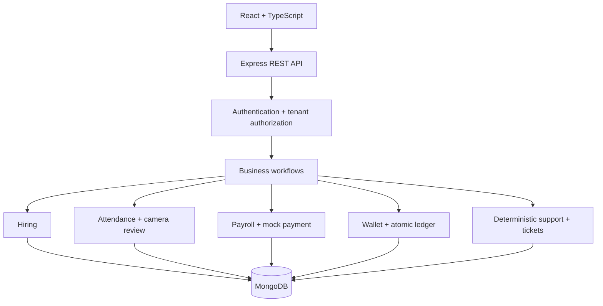

# HR Terra

HR Terra is a local HR operations demo built as a TypeScript MERN-style modular monolith. It includes real MongoDB persistence, cookie authentication, company-scoped APIs, employee and hiring workflows, attendance, payroll state transitions, wallets, a deterministic support assistant, and an accessible responsive dashboard.

This is an assessment demo, not a production-ready HR/payments system. The demo integrations (camera, support assistant, payment processor) are simulations. No real email, WhatsApp, Telegram, voice, AI, face recognition, or payment provider is connected.

## Feature status

- Implemented: signed HTTP-only cookie login/logout, bcrypt passwords, role checks, company-scoped queries, rate-limited login, safe errors, audit events.
- Implemented: employee create/list/search/edit/deactivate, hiring offer/accept/convert, attendance check-in/out, camera event review, salary structures, payroll draft/approve/mock-pay, company wallets with atomic ledger operations, support tickets, deterministic support chat.
- Implemented: React dashboard, employee/hiring/attendance/payroll/wallet/support/camera/audit views, TanStack Query cache refresh, polling fallback for dashboard metrics.
- Not implemented: Socket.IO, webhooks or live email/messaging/voice, leave requests, full employee detail/payslip permissions, payment request approvals, payroll adjustment/attendance deductions, assigning salary structures into payroll, provider failure/timeout reconciliation, production AI, full OpenAPI/Swagger, multi-document MongoDB transactions, and automated authorization/concurrency test suites.
- Known limitation: payroll mock payment is one aggregate payment per run; the payment and payroll updates are separate documents without transaction support. Do not use it for real payroll.
- Known limitation: payroll snapshots the employee's fixed `salaryCents` value as monthly gross. Salary structure components are stored separately and are not yet applied to that amount. New employee creation currently has no UI for salary entry.
- Production mode deliberately fails startup until real payment, CSRF, and provider adapters exist. The UI uses a small custom component style with Radix Dialog and Tailwind installed; generated shadcn/ui components are not included.

## Stack

- Client: React, Vite, TypeScript, React Router, Tailwind CSS, TanStack Query, React Hook Form, Zod, Radix Dialog, Recharts and Lucide.
- Server: Node.js, Express, TypeScript, Mongoose, MongoDB, Zod, bcrypt, signed JWT cookies, Helmet, express-rate-limit and Pino HTTP logging.
- Test tools: Vitest, React Testing Library, Supertest is not included yet.

## Architecture

See [docs/architecture.md](docs/architecture.md) for the design and data safety decisions.



## Requirements and local setup

Prerequisites: Node.js 20+, npm 10+, and MongoDB 6+ available at `mongodb://127.0.0.1:27017/hr-terra`.

```bash
cp .env.example .env
# Update JWT_SECRET and COOKIE_SECRET for local use if desired.
npm install
npm run seed
npm run dev
```

Open http://localhost:5173. The API runs at http://localhost:4000. Health routes: `/api/health/live` and `/api/health/ready`.

`npm run seed` is repeatable and upserts the demo companies, users, sample employees, candidates, salary structures, wallets, attendance, and a current-period draft payroll. Set `DEMO_PASSWORD` in `.env` to change the seed password. Never deploy with demo credentials.

### Demo accounts

All accounts use the password `TerraDemo!2026` by default (or `DEMO_PASSWORD` from `.env`). These are development-only credentials.

| Role                      | Email                          |
| ------------------------- | ------------------------------ |
| Platform admin            | `platform.admin@hrterra.local` |
| Terra Alpha company admin | `admin.alpha@hrterra.local`    |
| Terra Alpha HR            | `hr.alpha@hrterra.local`       |
| Terra Alpha payroll       | `payroll.alpha@hrterra.local`  |
| Terra Alpha employee      | `employee.alpha@hrterra.local` |
| Terra Beta company admin  | `admin.beta@hrterra.local`     |
| Terra Beta HR             | `hr.beta@hrterra.local`        |
| Terra Beta payroll        | `payroll.beta@hrterra.local`   |
| Terra Beta employee       | `employee.beta@hrterra.local`  |

## Scripts

```bash
npm run dev        # client and server
npm run build      # production client/server builds
npm run typecheck  # strict TypeScript checks
npm run lint       # ESLint
npm test           # Vitest suites
npm run seed       # deterministic demo data
```

The frontend reads `VITE_API_URL` when set; otherwise it uses `http://localhost:4000/api/v1`. See [.env.example](.env.example) and [docs/api.md](docs/api.md) for configuration and endpoints. `MONGODB_URI` can target Atlas or local MongoDB. The current demo avoids multi-document transaction calls, so a local replica set is not required; enable a replica set and transactions before making payroll production-safe.

### Environment variables

| Variable                                                                        | Use                                                                                     |
| ------------------------------------------------------------------------------- | --------------------------------------------------------------------------------------- |
| `NODE_ENV`, `PORT`                                                              | Development runtime and API port. Production mode intentionally refuses to start.       |
| `CLIENT_URL`, `CORS_ORIGIN`                                                     | Local client URL and comma-separated allowed browser origins.                           |
| `MONGODB_URI`                                                                   | MongoDB connection string.                                                              |
| `JWT_SECRET`, `COOKIE_SECRET`                                                   | Local signing secrets. Replace example values before sharing a development environment. |
| `LOG_LEVEL`, `DEFAULT_CURRENCY`, `DEFAULT_TIMEZONE`                             | Request log level and default company settings.                                         |
| `DEMO_PASSWORD`                                                                 | Password written to seeded demo accounts.                                               |
| `AI_PROVIDER`, `AI_API_KEY`                                                     | Reserved for a future AI provider; current support uses deterministic rules.            |
| `EMAIL_PROVIDER`, `EMAIL_API_KEY`, `WHATSAPP_PROVIDER`, `WHATSAPP_ACCESS_TOKEN` | Reserved for messaging adapters; no live sender is connected.                           |
| `TELEGRAM_BOT_TOKEN`, `VOICE_PROVIDER`, `VOICE_API_KEY`                         | Reserved for channel adapters; no live bot or voice service is connected.               |
| `PAYMENT_PROVIDER`, `PAYMENT_API_KEY`                                           | Only `mock` is implemented. Other values and production mode fail startup.              |

## Security and money decisions

All ordinary API data requests are scoped to the authenticated user's company. Platform admins can select a validated company with `X-Company-Id`; company roles cannot switch tenants. Employees only read their own employee profile and attendance/ticket records. Password hashes and salary fields are excluded from ordinary JSON responses. Money uses integer cents. Wallet balance and transaction entries are updated together in one MongoDB document using conditional atomic updates and an idempotency key.

Payroll currently provides a deterministic payment simulation and a company-period unique key. It is not backed by a real provider and does not claim safe multi-document transactional payment processing. Review [docs/security.md](docs/security.md) before extending the system.

## Production deployment considerations

Do not deploy this demo. Before a deployment, add a real payment adapter with idempotency and reconciliation, replica-set transaction coverage for payroll, CSRF protections, key management and rotation, strict manager and field-level authorization, automated tenant tests, monitoring and alerting, backups and recovery drills, PII retention and deletion rules, provider timeouts, and an API specification. Production startup currently fails closed to prevent the mock payment path from being mistaken for a real one.

## Troubleshooting

- MongoDB connection refused: start a local MongoDB service or update `MONGODB_URI` in `.env`, then rerun `npm run seed`.
- Login rejected: use a listed account and the current `DEMO_PASSWORD`; rerun `npm run seed` after changing it.
- Browser API errors: check that the client is at `CLIENT_URL`, that its origin is listed in `CORS_ORIGIN`, and that the API port matches `VITE_API_URL`.
- Production start fails: expected in this demo. A live provider and the missing production safeguards have not been implemented.

## Assessment notes

- Provider adapters: camera event simulation, deterministic rule-based HR support, and mock payroll payment.
- Automated verification includes a frontend sign-in rendering test and server payroll/attendance calculation tests. A manual local API smoke run also checked Alpha/Beta isolation, a forged company header, employee financial-data redaction, parallel candidate conversion, and wallet idempotency. Automated database-backed tenant/race and provider-failure suites are still incomplete.
- Another two days: add replica-set integration tests and transactions for payroll, per-employee payment reconciliation, CSRF tokens and refresh/revocation, employee payslips/manager permissions, real OpenAPI schemas, Socket.IO company rooms, and persisted unified channel conversations.
- AI tools used: OpenAI Codex assisted with implementation. The developer should review and adapt this generated code before submission.
- Architectural decisions: modular monolith; company scope derived from server-authenticated users; no biometric data; minor units for money; single-document wallet ledger update; review-only camera simulation.
- AI suggestions changed or rejected: the original prompt proposed a very broad production feature list. The implementation narrows scope to working, honest demo workflows and records omissions rather than presenting placeholders as complete integrations.
