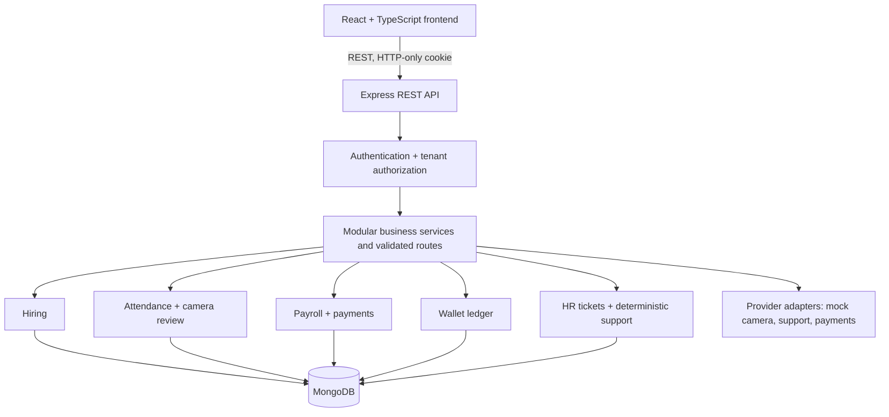

# HR Terra architecture

HR Terra is a modular monolith: one React client talks to one Express API, which owns authentication, tenant scoping, workflows, and MongoDB access. External providers are interfaces or deterministic mock implementations; a mock is never described as a live integration.

The browser never chooses a tenant by request body. Company users receive their company context from their authenticated database user. Only platform admins can supply `X-Company-Id`, and the API validates that company before any scoped query. All company-owned lookups include `companyId`.

## Data and concurrency decisions

- Money is stored as integer minor units (`*Cents`) and salary values are excluded from general employee responses.
- Unique compound indexes scope employees, candidate email, attendance dates, payroll periods, payment attempts, and camera events to a company.
- Candidate conversion reserves an employee ObjectId on the accepted candidate before insert. A retry completes or returns that same employee.
- Attendance enforces one record per employee and company-local date. Check-in is inserted once; checkout only updates a still-open record.
- A wallet balance and its transaction entries share one MongoDB document. Conditional updates enforce sufficient balance and idempotency atomically on that document.
- Payroll approval and processing use conditional state changes. The mock provider reuses one idempotency key and deterministic provider reference.
- HR support classifies a message deterministically and opens a ticket; it does not retrieve private payroll data or execute model-selected tools.

This demo does not use multi-document MongoDB transactions. The wallet uses single-document atomic writes. Payroll's payment and run records span documents and should use a replica set transaction plus provider reconciliation before production use. The process endpoint uses a deterministic mock result only.

## Trust boundaries

Passwords are bcrypt hashed. Authentication uses a signed, HTTP-only, same-site cookie. The API sets Helmet headers, allows configured CORS origins, limits login attempts, validates request bodies with Zod, redacts cookie headers in request logs, and formats errors without stack traces. Real camera identity, email/WhatsApp/Telegram/voice services, Socket.IO, real AI, and production payment connections are not implemented.
